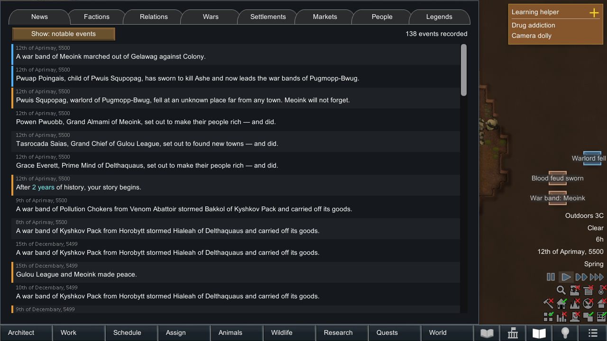
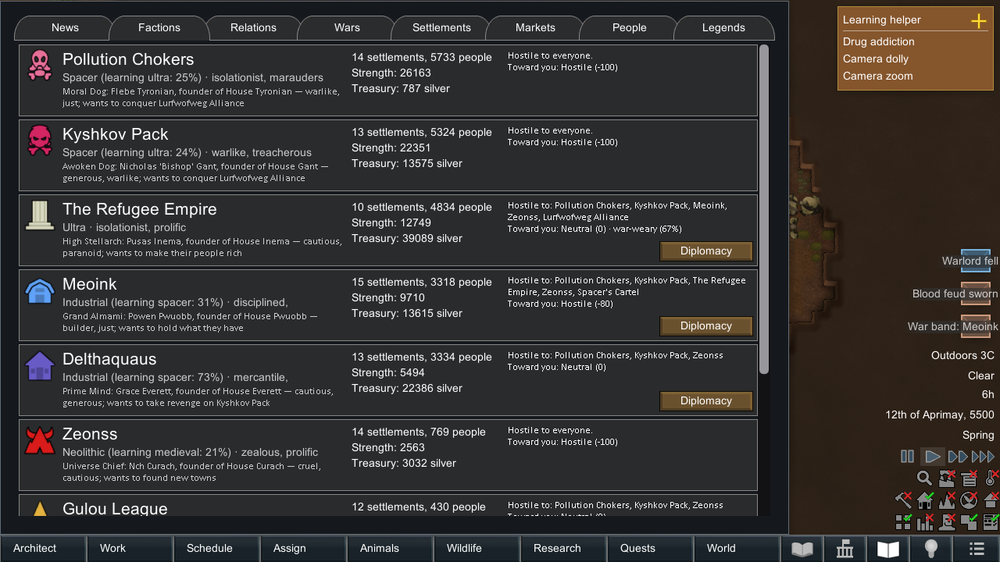
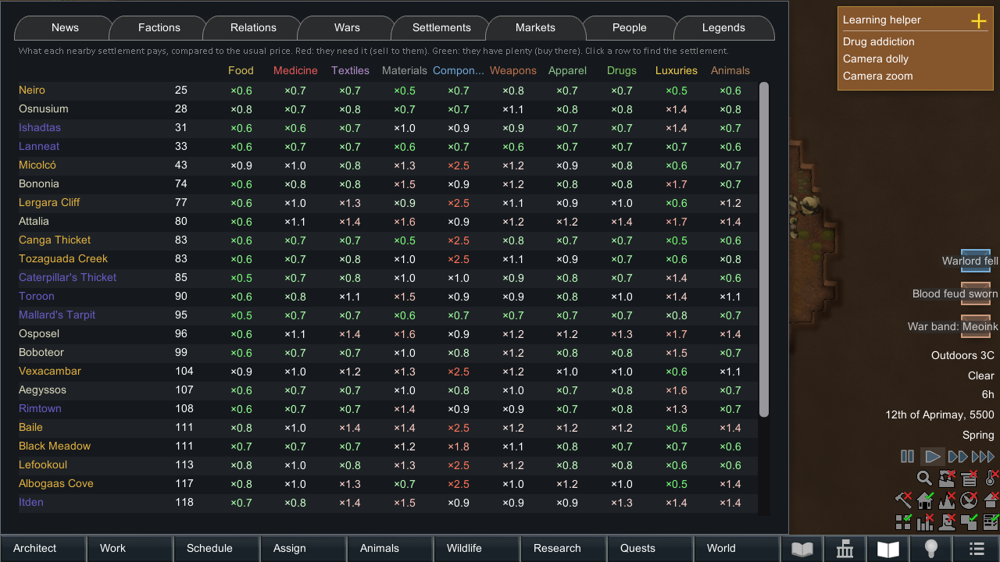
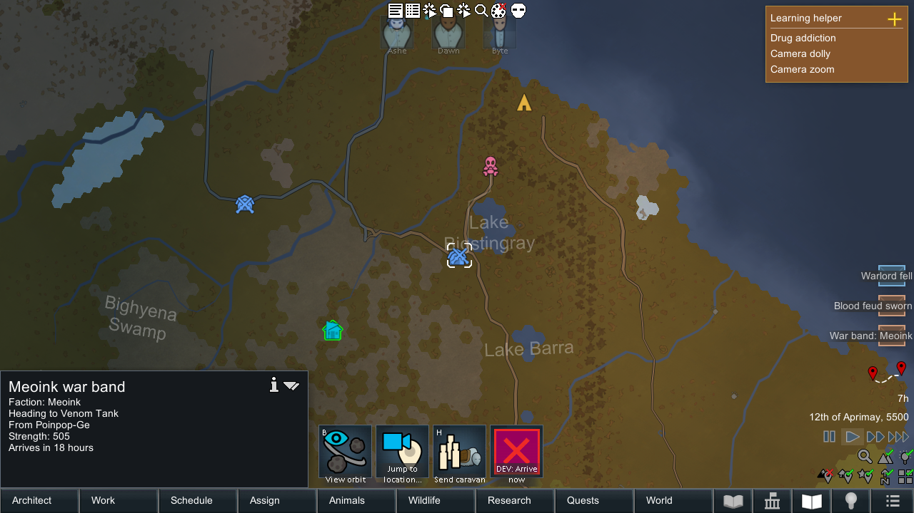
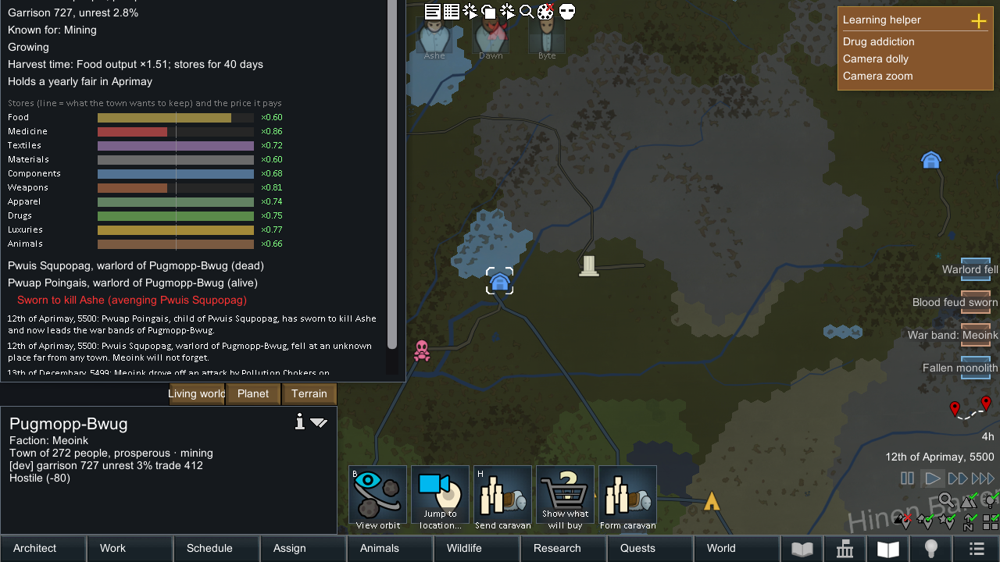
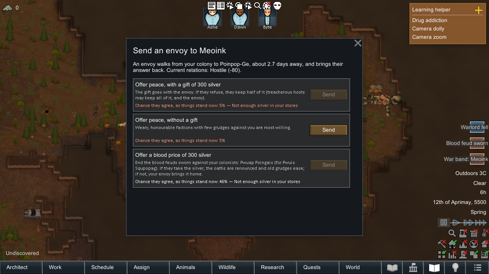

# Living World

> **Proof of concept, work in progress. AI-generated.** The code, tests, icons and most of these docs were written by
> AI coding agents (Claude via Claude Code, with reviews by Claude and GPT models), directed by one person. It passes
> automated in-game tests in a headless harness, but it has not been played on a real save yet, has not had a
> line-by-line human review, and is not on the Steam Workshop. Use it on a copy of your save. How it was made and
> tested, and what was not tested: [docs/HOW-IT-WAS-MADE.md](docs/HOW-IT-WAS-MADE.md).
>
> Community-made mod. Not affiliated with or endorsed by Ludeon Studios. RimWorld is © Ludeon Studios.

RimWorld 1.7 mod (work in progress). The world beyond your colony is a living simulation in the spirit of Dwarf
Fortress. Factions, settlements and people keep living, trading, fighting and changing on their own. What the
storyteller sends you comes from that world, and what you do feeds back into it. Requires
[Harmony](https://github.com/pardeike/HarmonyRimWorld).

## Screenshots

Taken by the automated UI tour (`tools/uitour.sh`) on a test world after two years of generated history, in dev mode
(hence the dev buttons).

| | |
|---|---|
|  |  |
| The Chronicle's news: wars, foundings, a warlord's death and the blood feud it started | Factions with their age, temperament, ruler, goal, strength and treasury |
|  |  |
| What nearby towns pay for each kind of goods | A war band marching on an enemy town |
|  |  |
| A town's stores, prices, season and notable people, with a sworn avenger | Sending your own envoy: peace, a gift, or a blood price |

## What it does

**A world that lives**
- Every NPC settlement has a population, prosperity, a garrison, unrest and stocks of ten commodity kinds (food,
  medicine, textiles, materials, components, weapons, apparel, drugs, luxuries, animals). They are produced from the
  land and the faction's tech level, and consumed by the people.
- Food follows the seasons: towns harvest in summer and live off their stores in winter, so prices and shortages
  have a yearly rhythm (longer winters, bigger stores).
- Settlements grow into villages, towns and cities, or starve and shrink. They have a specialty ("mining town",
  "farming village") and suffer plague and blight, or hold great fairs.
- Factions have temperaments (warlike, mercantile, expansionist, honorable, treacherous, …), a treasury, war
  weariness and grudges.
- **An age of change:** factions learn. A tribe that prospers and trades with advanced neighbours reaches the
  medieval age, then the industrial; outlanders become spacers. Their economy grows, they fight harder, and their
  raiders bring better weapons. When a big faction enters a new age, its most traditional town may break away and
  keep the old ways. If wars (or you) wipe peoples out, or no tribes or no advanced peoples are left, new peoples
  arrive from beyond the known lands and settle empty land.
- **Rulers matter:** each ruler has a temperament of their own (ambitious, cautious, cruel, just, builder, …) and a
  goal: conquer a weaker enemy, avenge a grudge (perhaps against you), make their people rich, found new towns.
  Goals steer wars, peace and expansion, and succeed or are given up in the chronicle. A disputed succession can
  split a large faction.
- Diplomacy runs on vanilla goodwill, so pawns on maps agree with the world. Neighbours drift apart, trade partners
  grow closer, wars are declared for reasons, allies join in, envoys carry peace offers and alliances.
- **Wars:** war bands march on enemy settlements and plunder, conquer or (rarely) raze them. Factions can be wiped
  out. Occupied towns resent their masters and may rise up. Big factions can split, and rebels found a new faction.
- **Expansion:** settlers found new towns and rebuild ruins.
- **History before you land:** a new world first lives through some years (setting, default 2). It starts with wars,
  ruins, new towns and a chronicle reaching back.

**You can see it happen**
- Parties travel on the world map: merchants carrying goods between towns, war bands, envoys, settlers, travellers.
  Select one to see where it goes, what it carries and when it arrives.
- The **Chronicle** tab (book button) has the following pages:
  - *News:* the world's history, with dates, filters and jump-to.
  - *Factions:* traits, leader, strength, treasury, enemies.
  - *Wars:* causes, battles and who is winning.
  - *Settlements:* sortable table.
  - *Markets:* what nearby towns pay for each good.
  - *People:* notable figures.
- World news comes as a periodic digest letter. Events that involve you get their own letter.

**The storyteller's events come from the world**
- When the storyteller sends a raid, a war band sets out from a real hostile settlement. You get a warning with its
  origin and ETA, and can watch it march. Meet it with a caravan and you fight it on the road; beat it there and it
  never reaches your colony.
- Trade caravans and visitors also walk in from real towns. Afterwards they go home with what they earned, and
  raiders go home with their survivors. Losses weaken their home town.
- **Recurring people:** the merchant who traded with you comes back with the next caravan from that town, and the
  warlord who raided you leads the next war band in person. Kill a warlord and their town is weakened and swears
  revenge.
- **Markets:** trade prices follow the trader's home market. A starving town pays far more for food, and a town at
  war pays more for weapons. The price tooltip tells you why. Your trades move that market.
- **Aid requests:** a nearby town in famine or shortage sends a messenger. Help it in time and you earn goodwill and
  fame there.
- **Fame:** treat a town's visitors well and your name is good there, which means better prices. Friendly towns
  nearby where you are well known send merchants and visitors of their own accord.
- **Colonists have roots:** a recruit remembers their home town and is shaken when it is razed, conquered or
  plundered, and glad when you help it. Colonists talk about the wars, prices, famines and their home towns.
- Merchants on the road stop to trade with your caravans.
- **Requests and demands:**
  - An ally at war asks you to destroy an enemy town, for silver and friendship.
  - A strong, warlike neighbour demands tribute. Pay and its raids go elsewhere for a season; refuse and it marches.
  - Refugees from a nearby razed or starving town ask to lodge with you.
- **Your own diplomacy:** the *Diplomacy* button on the Chronicle's Factions page sends an envoy walking to a
  faction's nearest town. The envoy can offer peace to an enemy (a gift helps; treacherous hosts may keep it and
  the envoy), call an ally to march against one of your enemies, or demand tribute from a weaker neighbour. The
  dialog shows each offer's chance of acceptance, and the envoy comes back with the answer.
- **Yearly fairs:** prosperous towns hold a week-long fair at a fixed time in their warm season. You hear of it a
  few days ahead, friendly colonies nearby are invited, the market restocks, and trading there gets better prices.
- **Visitors bring their world with them:** people from a sacked, starving or warring town are shaken (and the
  hungry eat first), people from a fair are cheerful, and they tell your colonists about it. Old acquaintances
  greet each other, and at high goodwill a ruler may come along in person with a proposal: a trade pact, a war to
  join, leave to found a town near you, or a gift.
- **Prisoners have a home:** a captured raider is from a real town. Their faction may offer a ransom; set them
  free and that town remembers it kindly, let them die in your cells and it holds a grudge. Their next visitors
  say so to your colonists, and a captive you freed may come back one day with a gift, looking for the colonists
  who were kind to them.
- **Family in the world:** someone who joins you from a real town may leave a parent there. The parent may come with
  that town's visitors to see them, and if the town is razed your colonist may lose them.
- **Commissions:** a merchant who knows you may order goods their town is short of (medicine, cloth, components,
  …) for their next visit, at a better price. Deliver and the town's shortage eases and your name rises there.
- **Visitors ask for help:** people from a starving town ask to buy meals; someone from a sacked town asks to stay;
  visitors from a town at war may hire your best spare fighter. The colonist travels there, fights for a few days and
  walks back in, usually with pay and plunder, sometimes wounded, rarely not at all. Someone grown always stays home.
  While away they are not on the colonist bar; their party is on the world map.
- **Raiders' morale follows the world:** war-weary raiders or men whose home town fell break sooner; a ruler's
  sworn vengeance makes them hold on.
- **Your deeds are remembered:** destroy a settlement and it goes into the chronicle. Its colonists grieve, and its
  faction swears revenge. Visitors bring news from their region.
- **Blood feuds:** kill a warlord and their child (or a sworn comrade) may swear to kill the colonist who did it. The
  avenger takes over that town's war bands, comes for the slayer, and returns while the feud stays open. Kill or
  capture them to end it, or send an envoy with a blood price. The hunted colonist feels it until it's over.
- **Careers:** a merchant who keeps coming becomes a merchant prince with a heavier purse, and a warlord who keeps
  raiding becomes a dread warlord with bigger war bands. Old ones retire, and their grown child takes over.
- **Ruling houses:** each faction is ruled by a house. Usually an heir carries the name on ("of House Vane, 3rd of the
  line"). Sometimes a rival house seizes the rule, and a big faction may split over it, with the deposed house leading
  the breakaway.
- **Rulers can fall:** when a faction's capital is taken, its ruler may die there, and a successor takes over.
- **Legends:** the Chronicle's *Legends* page shows your colony's renown and each colonist's deeds (a warlord slain,
  a fight abroad, a refugee taken in), the dead too.
- Each settlement has a *Living world* inspect tab on the world map: people, market, notable people and history. The
  Chronicle also has a *Relations* matrix.

## Reporting lag

Mod settings → Living World → *Performance log* writes one line per in-game day to
`<save data folder>/LivingWorld/perf-<date>.csv` (real seconds per day, tick and frame cost, time spent in Living World,
all map components, Spaceports and Hospitality). Send that file along with a lag report.

## Compatibility

- **Hospitality (Continued)** (`Orion.Hospitality`): guests come from real towns as world parties. How they were
  treated feeds into your fame there.
- **Rimsential Spaceports (Continued)** (`zal.spaceports`): with a spaceport, spacefaring visitors and traders fly in
  instead of walking. Upstream Spaceports has no 1.7 build yet; `tools/compat/build-spaceports-1.7.sh` builds one from
  its source. Details: [docs/compat-hospitality-spaceports.md](docs/compat-hospitality-spaceports.md).
- Other mods that replace the vanilla raid, trader or visitor incident workers: Living World detects them, keeps
  their behaviour and only skips the "travel on the world map" part.
- Odyssey: only surface settlements take part. Colonies off the surface get vanilla arrivals.
- Every subsystem can be switched off in the mod settings. To remove the mod from a running save, use *Prepare this save
  for removing the mod* in the settings, then save. This switches the simulation off for that save only.

## Building

The build compiles against the game's own DLLs, so you need a RimWorld 1.7 Windows install. The Makefile and the
csproj look for `Assembly-CSharp.dll` in the repo folder or any folder above it, and in a `RimWorld/` subfolder of each
of those (for example `~/RimWorld` next to `~/rim-mods/living-world`). Anywhere else, set `RIMWORLD_DIR=/path/to/RimWorld`.

Requirements: .NET SDK 10 (the mod targets `net10.0`, like 1.7 itself), NuGet access for `Lib.Harmony` 3.0.0-rc.3, `make`.

| Target | What it does |
|---|---|
| `make build` | builds the mod into `Mods/LivingWorld/Assemblies/` |
| `make lint` | build + offline check of every XML def field and reference against the game's types |
| `make test DAYS=n PLAN=p` | lint + in-game autotest under the headless harness (see below) |
| `make link` | symlinks `Mods/LivingWorld` into the game's `Mods/` folder so the game loads this checkout |
| `make dist` | writes `dist/LivingWorld/` and `dist/LivingWorld.zip` (override with `DIST_DIR=`) |
| `make clean` | removes build output |

## Testing

`tools/autotest.sh [days] [plan]` starts a quick game with a fixed seed. It runs the given days as fast as possible,
saves and reloads halfway, checks invariants and prints `[LivingWorld:test] PASS|FAIL`. Plans:

| Plan | What it exercises |
|---|---|
| `normal` | storyteller raid, trade caravan and visitors as world parties, market probe, recurring figures, save/load |
| `history` | 10 years of pre-landing history with yearly balance lines |
| `hospitality` | the same with Hospitality |
| `spaceports` | a built spaceport with Spaceports + Hospitality: shuttles land |
| `roadtrade` | a player caravan trades with merchants on the road |
| `intercept` | a player caravan meets a war band (encounter maps need a windowed run: `RW_WINDOWED=1`) |
| `refugees` | a nearby disaster sends refugees (vanilla lodger quest, Royalty) |
| `demands` | tribute: refusing or ignoring it starts a vendetta, paying uses silver on the map and keeps that faction's raids away; war request rewards; per-save removal switch |
| `prisoners` | captives (ransom, death in captivity, release), visitors' pleas, mercenary contracts, kin, blood feuds (sworn, hunted, ended, avenged, blood price, warnings) and careers (merchant princes, dread warlords, retirement) |
| `ages` | raider weapons of a faction's learned age, a faction advancing and its old ways splitting off, a new people arriving, a deposed house leading a breakaway |
| `diplomacy` | the colony's envoys: peace, tribute, call to arms (forced answers), and one envoy walking there and back; ruling houses |
| `life` | a month on Peaceful with nothing forced (colonists kept fed): what visits, orders and pleas happen on their own |
| `stress` | full planet (about 900 settlements): performance per in-game day |
| `uitour` | `tools/uitour.sh`: windowed run with a screenshot of every page |

`tools/regression.sh` runs the main plans in parallel on the native Linux build. Every game takes one of five
machine-wide slots (`tools/rw-slot.sh`) and waits for free memory, so runs from several repositories share the machine.

The games run under the headless harness of [ColonyScale](https://github.com/UrekD/ColonyScale)
(`tools/headless/run-game.sh`: offline, Xvfb, the Windows build under portable Wine or the native Linux build). Check
it out next to this repo as `colony-scale`, or point `RW_RUNNER` at its `run-game.sh`. `RW_GAME_DIR=/path/to/RimWorld`
picks the install to run (for example a native Linux build). The tests need a save-data folder with a
`Config/ModsConfig.xml` enabling Harmony, Core, the expansions and `urekd.livingworld` in `.work/savedata/`.

## Sources and credits

Used to build, run or test the mod:

- **[RimWorld](https://rimworldgame.com/)** by Ludeon Studios. The mod compiles against the game's DLLs, and vanilla
  methods were read in decompiled form for reference. That is allowed by the [RimWorld EULA](https://rimworldgame.com/eula/),
  which says mods must be free and must be presented as community-made. No game files or decompiled sources are in
  this repository.
- **[Harmony](https://github.com/pardeike/Harmony)** by Andreas Pardeike (MIT): the patching library (`Lib.Harmony`
  NuGet, compile-time only). At runtime it comes from the **[Harmony mod](https://github.com/pardeike/HarmonyRimWorld)**
  (`brrainz.harmony`, MIT).
- **[ColonyScale](https://github.com/UrekD/ColonyScale)** (Unlicense): the headless test harness. It uses
  **[Wine](https://www.winehq.org/)** (LGPL-2.1+) in the portable builds by
  **[Kron4ek/Wine-Builds](https://github.com/Kron4ek/Wine-Builds)**, **Xvfb** (X.Org) and Mesa's lavapipe for the
  windowed screenshot runs.
- **[ILSpy / ilspycmd](https://github.com/icsharpcode/ILSpy)** (MIT): decompiling the game for reference.
- **.NET SDK** (Microsoft, MIT).

Integrations (no code copied; built from their source only to test against them, not distributed here):

- **[Hospitality (Continued)](https://github.com/Zaljerem/Hospitality)** by Orion, continued by Zaljerem (GPL-3).
  Living World calls it only through reflection at runtime.
- **[Rimsential Spaceports (Continued)](https://github.com/Zaljerem/RimsentialSpaceportsContinued)** by Zaljerem
  (MIT). `tools/compat/` holds our own project file and script that build it for 1.7 from a checkout of its source.
- **[Space Services](https://github.com/jdubarb/spaceservices)** by jdubarb (GPL-3.0): its source was read while
  working out which mod "space visitors" meant. Not integrated.

Inspiration (ideas only; their code was not used):

- **Dwarf Fortress** by Bay 12 Games: the idea of a world with its own history that keeps going around the player.
- **[RimWar](https://github.com/TorannD/RimWar)** by TorannD (MIT), **[World Domination](https://steamcommunity.com/sharedfiles/filedetails/?id=3646291383)**,
  **Dynamic Diplomacy** and **More Faction Interaction**: earlier RimWorld mods with world-map war bands, NPC wars and
  diplomacy. They were studied from their public descriptions and player feedback to decide what to do differently
  (for example, routing the storyteller's own incidents through the world instead of adding a second stream of
  events).

AI tools used to write the code are listed in [docs/HOW-IT-WAS-MADE.md](docs/HOW-IT-WAS-MADE.md).

## License

[The Unlicense](LICENSE): public domain, so anyone may do anything with it. No warranty. This covers the code in this
repository only, not RimWorld or the third-party projects above.
